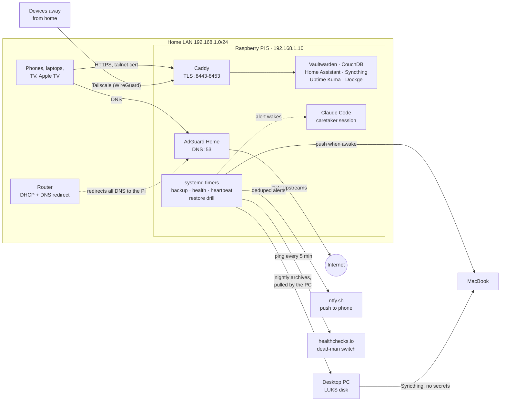

# Raspberry Pi homelab

[](https://github.com/gallowforge/homelab/actions/workflows/validate.yml)
[](LICENSE)

One Raspberry Pi 5 runs a household's DNS, password vault, notes sync, smart home and
monitoring. Every hand-written piece of its configuration lives in git, host files
included, and a script proves the live machine still matches the repo. An always-on
Claude Code session works as the on-call operator, bound by a written charter.

This is a public copy of the private repo that runs the Pi. It has been sanitized, and
some services are left out (see [What this copy leaves out](#what-this-copy-leaves-out)).

## In summary

A Raspberry Pi 5 booting from a USB flash stick serves every device in the house: AdGuard
for DNS, Vaultwarden for passwords, CouchDB for notes sync, Syncthing for a 65 GB personal
vault, Home Assistant, and Uptime Kuma, each a Docker Compose stack behind one Caddy front
door. Nothing is forwarded on the router; devices away from home come in over Tailscale,
and the same HTTPS links work at home because AdGuard answers the tailnet name with the
LAN address. Every night a backup engine writes, verifies and only then prunes each data
set, the archives leave the Pi for two other machines, and a weekly drill restores the
newest ones into RAM and compares them with live data. Failures reach one phone as one
deduplicated push, from systemd, Uptime Kuma, a daily health check and an external
dead-man switch, and an always-on Claude Code session investigates them under a written
charter. Every hand-written file, host configuration included, lives in this repo at its
live path, and an install tool shows any difference between git and the machine before
and after each change.

## Goals, in priority order

When two goals conflict, the lower number wins.

1. **Never lose data.** The password vault, notes, personal vault, Home Assistant config
   and the backups themselves come before uptime and before convenience. A backup counts
   only once a restore has read it back.
2. **Private by default.** Nothing is reachable from the internet unless that was a
   deliberate, written decision. No forwarded ports, no new public names, no secret in git.
3. **The house keeps working.** DNS first, then the vault and Home Assistant. Risky work
   happens after the backup, one container at a time, and fails loudly instead of quietly
   falling back to something that half works.
4. **Every change is visible, reproducible and reversible.** Git holds every hand-written
   file, the install tool refuses to apply uncommitted host files, and the operator's
   actions are in the git log and a journal. One command stops the operator.
5. **Low maintenance.** Automated checks over manual care. A manual step that has to be
   remembered is treated as a bug in the tooling.

Two examples of the order at work: the hardware watchdog stays off, because on this flash
stick an abrupt reset costs data (1 beats 3). Updates wait for the verified nightly backup
and a 3-day cooldown, even though that leaves known fixes uninstalled for a few days
(1 beats 5).

## Architecture



## By the numbers

Figures are from the live Pi's repo and runbooks as of November 2026.

- **15 containers** on one Pi 5 (8 GB). 9 of them are in this copy.
- **20 systemd timers** for homelab jobs, **0 cron jobs**. 13 of the timers are in this copy.
- **12 backup sets** every night at 05:00, about 2.5 minutes for all of them. Each archive
  is verified before anything older is pruned. Copies live on **3 machines**.
- **Weekly restore drill**, Sunday 05:45: the newest archive of every set is unpacked
  into RAM and checked against live data. About 10 seconds.
- **Daily health check**: 21 alert categories, 77 distinct alert conditions. They cover
  what an HTTP monitor cannot see.
- **13 Uptime Kuma monitors**, every 60 seconds.
- **External dead-man switch**: a heartbeat every 5 minutes. healthchecks.io alerts after
  20 minutes of silence.
- **376 commits** since the repo started on 2026-09-17.
- **About 1,900 lines** of top-level runbooks and charter, 1,900 lines of per-stack notes,
  and a 1,000-line operating journal.
- **Rebuild target**: 2-3 hours from bare hardware, plus the vault re-sync in the
  background. The data sets were rehearsed end to end on another machine in about
  10 minutes.

## Services

| Service | What it does | How it is reached |
|---|---|---|
| AdGuard Home | DNS and ad blocking for every device in the house | `:53`; web UI through Caddy `:8445` |
| Caddy | The only TLS front door. One port per site, tailnet certificate | `:8443-8453` |
| Vaultwarden | Bitwarden-compatible password server | Caddy `:8452` only, no host port |
| CouchDB | Obsidian LiveSync backend | Caddy `:8450` only, no host port |
| Home Assistant | Home automation, HomeKit bridges, Hue scenes, TV picture mode | Caddy `:8443`; LAN `:8123` for phone shortcuts |
| Syncthing | Replicates a 65 GB personal vault to the PC and the MacBook | GUI through Caddy `:8453` |
| Uptime Kuma | Endpoint monitors, alerts through ntfy | Caddy `:8446` only, no host port |
| Dockge | Web UI for the compose stacks. Holds `docker.sock` | Caddy `:8444` only, no host port |
| Watchtower | The only automatic updater, with tiers and a cooldown | none |
| HyperHDR + tv-mood | Hue lamps follow the TV picture | host services, see [docs/tv-ambient-lighting.md](docs/tv-ambient-lighting.md) |
| Claude Code | Always-on operator session | host service, see [docs/ai-operator.md](docs/ai-operator.md) |

Host: Raspberry Pi OS Lite 64-bit (Debian 12), Docker CE with Compose, Tailscale. The root
filesystem is on a USB flash stick. That shapes many decisions below.

## Design decisions

### Tailscale instead of port forwarding
The ISP puts the house behind CGNAT and gives no IPv6, so port forwarding is not an
option. Tailscale gives every device a WireGuard path to the Pi from anywhere. Caddy serves
the tailnet's own certificate (`tailscale cert`, renewed weekly, Caddy reloaded with
`--force` because the config text never changes on renewal).

At home the same links work without Tailscale. AdGuard rewrites the Pi's tailnet name to its
LAN address, and the certificate is valid for that name. One set of bookmarks works
everywhere.

### A small, fixed public surface
Nothing on the router is forwarded. The live Pi publishes exactly one name to the internet
through Tailscale Funnel, for a service that is not part of this copy. The rule is written
down: no new public names, no new open ports.

Plaintext ports were closed when Caddy took over: Vaultwarden `:8222`, Uptime Kuma
`:3001`, Dockge `:5001` and CouchDB `:5984` have no host port at all. AdGuard's and
Syncthing's admin UIs still listen for Caddy but ufw denies them to the LAN.

### Closing Docker's ufw bypass
Docker publishes ports with DNAT in the FORWARD chain, so ufw's INPUT rules never see that
traffic. A port that looks firewalled is open. [`_host/etc/ufw/after.rules`](_host/etc/ufw/after.rules)
fills the `DOCKER-USER` chain at every ufw reload: new connections that arrive on `eth0`
from outside the LAN are dropped. The LAN, the tailnet and container-to-container traffic
are untouched.

Containers reaching the host are limited too. ufw admits only DNS and three host-network
ports (AdGuard UI, Home Assistant, Syncthing GUI) from Docker networks. Anything else a
container tries shows up as a `[UFW BLOCK]` line.

### No fallback DNS, on purpose
The router hands out the Pi as the only resolver and redirects queries for any other
resolver to it. That makes the Pi a single point of failure for house DNS, and it is a
deliberate choice. A second resolver was tried: Apple devices raced both, got NXDOMAIN for
the tailnet name from the public one, and lost every local link.

The risk is managed instead of spread:
- AdGuard uses parallel DoH upstreams with fallback servers given by IP.
- AdGuard and Vaultwarden run with `oom_score_adj: -500`.
- Uptime Kuma queries DNS every 60 s, and the health check sends an urgent push if
  `127.0.0.1:53` stops answering.
- Watchtower recreates one container at a time, so an AdGuard update costs about 2 s of
  DNS.

### Backups are verified before anything is pruned
A backup engine that deletes old archives after writing a broken new one is worse than no
engine. [`homelab-backup`](_host/usr/local/sbin/homelab-backup) reads one list,
[`backups.conf`](_host/etc/homelab/backups.conf). It takes SQLite copies with the online
backup API, runs `PRAGMA quick_check`, checks a row count and checks that the required
members are in the finished archive. Only then does it prune older archives, and it never
prunes the newest three. A failed set keeps everything it had and sends one push.

`forbid` rules fail any set that would carry a `.env` or key file to the laptop. Details:
[docs/backups-and-restore.md](docs/backups-and-restore.md).

### The repo is the source of truth, and drift is checked
Host files live under [`_host/`](_host) at their live paths.
[`MANIFEST`](_host/MANIFEST) lists each one with its mode, owner and what to do after a
change. [`install.sh`](_host/install.sh) has four modes:

- **diff** (default): compares every entry with the live system and ends with
  `RESULT: no drift` or a list of differences.
- **`--apply`**: installs with `install(1)` and keeps the old file. It refuses to run while
  `_host/` has uncommitted changes, so the repo always says what is installed.
- **`--pull`**: copies a file that a tool rewrote (ufw rewrites `user.rules`) back into the repo.
- **`--bootstrap`**: on a rebuilt host, creates the Docker `proxy` network and enables every
  timer in the MANIFEST.

It also reports files in homelab locations that the MANIFEST does not know, and timers that
are installed but not enabled. The daily health check runs the same comparison, so drift
becomes a push instead of a surprise. A pre-commit hook refuses commits that look like they
contain a secret.

### Updates in tiers, after the backup
Watchtower is the only updater. It runs at 05:30, after the verified 05:00 backup, only
for containers labelled for it. It applies an image only once that image is more than
3 days old, one container at a time, waiting for each to become healthy. Image tags track
major lines (`caddy:2`, `couchdb:3.5`), so a new major version never arrives by itself.

Vaultwarden is the exception: it publishes only `:latest`. The health check reads its
GitHub releases and warns the first morning a new major version appears, before the
cooldown ends.

A container can be excluded by name. The live Pi does this for a Tailscale sidecar whose
restart withdraws a public DNS name for up to 18 minutes.

### Written for a flash stick
The root disk is a USB flash stick that loses recent writes on an abrupt reset. So:

- Scratch data and high-frequency state live in RAM: `/run`, `/dev/shm`, zram swap.
- The journal is capped, and chatty units log at `notice`.
- The health check alerts on more than 20 GiB/day of writes and on the USB link
  dropping to USB 2 speed.
- The hardware watchdog is deliberately not armed. A watchdog reset is an abrupt reset,
  and that costs data here.

### One switch for planned work
`sudo touch /run/homelab/maintenance` before stopping containers. While the flag exists,
the AdGuard pin and the network probe skip their runs, alerts do not wake the caretaker,
and the heartbeat gate ignores Uptime Kuma's state. `/run` is emptied at boot, so a
forgotten flag cannot outlive a reboot.

## Past failures and what changed

Each of these cost an outage, data, or a morning of diagnosis. Each ended in a change to
the configuration, a new check, or a written rule the operator follows.

1. **Remote access through a public domain, and a VPN that never connected.**
   - *What broke:* the first setup published about 17 services under a public domain,
     first with its own certificates, then behind a Cloudflare Tunnel. A self-hosted
     WireGuard server ran alongside it and never completed a handshake. Four stale port
     forwards to the Pi, DNS among them, were still open on the router.
   - *Root cause:* the ISP uses CGNAT, so nothing inbound can reach the house, and the
     public names put admin panels on the internet for no real gain.
   - *Now:* Tailscale only. Port forwarding and UPnP are off, WireGuard was purged with its
     keys and firewall rules, and the tunnel and domain are gone. Written rule: no new
     public names, no new open ports.

2. **A fallback DNS server broke every local link on Apple devices.**
   - *What broke:* the router handed out a public resolver as a second DNS server so the
     house would survive the Pi going down. Apple devices then lost the Pi's name, and
     every bookmark to it stopped working.
   - *Root cause:* Apple's resolver races all configured servers. The public one answered
     NXDOMAIN for the private name, and that answer often won.
   - *Now:* the Pi is the only resolver and the router redirects any other DNS to it. The
     single point of failure is managed in place (see
     [No fallback DNS, on purpose](#no-fallback-dns-on-purpose)). Hard rule: never add a
     fallback resolver for clients.

3. **Arming the hardware watchdog reset the Pi and damaged the boot partition.**
   - *What broke:* minutes after a 15-second systemd watchdog was armed, the Pi reset
     itself during a 3-second backup run. The boot-time FAT check truncated `cmdline.txt`
     to 0 bytes, the newest git objects came back empty, and three container logs had runs
     of NUL bytes. That boot worked only because the bootloader had already read the old
     file; the next one would not have found the root filesystem.
   - *Root cause:* PID 1 most likely blocked for more than 15 seconds on writes to the
     flash stick, and the stick lost its recent writes in the abrupt reset.
   - *Now:* the watchdog is off by design. Rebooting, editing `/boot/firmware`, forcing
     fsck and arming the watchdog happen only with someone at the Pi. The health check
     reports every abrupt reset. `cmdline.txt` was restored from a checksummed copy and
     the repo from its previous commit, with `git fsck --full` clean.

4. **A memory leak made the whole house's internet feel slow.**
   - *What broke:* "the internet is very laggy". The internet was fine. The Pi had 55 MB
     free, swap full on the flash stick and a load of 36, and every DNS lookup in the house
     waited on it.
   - *Root cause:* `tv-mood` opened a new HyperHDR connection every second, and HyperHDR
     leaks memory per connection: 2.6 GB in under two days. `MemoryMax=` would have capped
     it, but Raspberry Pi OS boots with the memory cgroup disabled, so systemd memory limits
     silently do nothing.
   - *Now:* one kept-open connection. `hyperhdr-guard.timer` restarts HyperHDR past
     300 MB, 1 GB of zstd zram swap sits ahead of the swap file on the stick, and the health
     check alerts below 800 MB available, naming the biggest process. Runbook order for
     "the internet is slow": the Pi first, then the ISP.

5. **Watchtower reported healthy while it could not reach Docker.**
   - *What broke:* two scheduled update runs failed with "Cannot connect to the Docker
     daemon". The container's health check stayed green and nothing alerted.
   - *Root cause:* restarting dockerd recreates `/var/run/docker.sock`. A container that
     bind-mounts it keeps the old, deleted inode.
   - *Now:* the health check compares the socket inode inside every container that mounts
     it with the host's, and names the container to restart.

6. **A partial upstream fault became a 25-minute whole-house DNS outage.**
   - *What broke:* house DNS nearly stopped answering. The network probe reported it as
     24% international packet loss, and the operator session went deaf too, because its
     own lookups use the same resolver.
   - *Root cause:* plain DNS to public resolvers timed out upstream while TCP still worked.
     AdGuard's browsing-security feature makes every query, cached ones included, wait on a
     lookup at a server abroad; about 3,600 connections piled up there and turned a partial
     fault into a total one. The probe resolved its targets by name, so it could not tell a
     DNS failure from packet loss.
   - *Now:* browsing security is off. The probe gives a lookup 5 seconds, then tests the
     last known address, and reports lookup failures as their own category. No automatic
     AdGuard restart was added: a restart would not have helped, and DNS is not restarted
     automatically without evidence that it fixes something.

7. **The restore drill failed a backup that was fine.**
   - *What broke:* the weekly drill failed the secrets set: 1 of 24 restored files differed
     from live.
   - *Root cause:* Home Assistant runs its own nightly backup at a drifting time near
     05:00, sometimes after ours, and rewrites the history part of the file that holds its
     backup encryption key. The key, the reason the file is backed up, was identical.
   - *Now:* the drill checks that file by its key only and lists files modified after the
     archive in the PASS line instead of failing. A changed key still fails, tested with a
     tampered copy. A drill that cries wolf teaches people to ignore it, so the test was
     fixed rather than re-run.

## How a change is made

1. Edit the file in the repo (host files: the copy under `_host/`).
2. `git commit`. The pre-commit hook blocks known secret patterns and prints only
   `file:line` and the rule name.
3. `sudo _host/install.sh` shows the diff against the live system;
   `sudo _host/install.sh --apply` installs it.
4. Verify from a client's point of view, then `sudo homelab-health.sh --dry-run` must end
   with `all healthy`, and `sudo _host/install.sh` with `RESULT: no drift`.

## Repository layout

```
.
├── adguard/                 DNS: compose file, self-healing rewrite pin (pin-update.sh)
├── caddy/                   TLS front door: compose file, Caddyfile
├── couchdb/                 Obsidian LiveSync backend
├── dockge/                  compose UI
├── homeassistant/           compose file, YAML config, Hue scenes, TV picture mode
├── syncthing/               vault replication
├── uptime-kuma/             endpoint monitors
├── vaultwarden/             password server
├── watchtower/              tiered updater
├── _host/                   host files, stored at their live paths
│   ├── MANIFEST             every host file: mode, owner, follow-up after a change
│   ├── install.sh           diff, apply, pull, bootstrap
│   ├── etc/                 docker, ufw, fail2ban, journald, sysctl, tmpfiles,
│   │                        systemd units, the backup list
│   ├── usr/local/           backup engine, health check, notifier, heartbeat gate,
│   │                        netprobe, caretaker scripts, tv-mood
│   ├── backup-restore-test.sh   the weekly restore drill
│   ├── watchdog-tests.sh        stubbed tests for the notifier and netprobe
│   └── git-hooks/pre-commit     refuses secrets
├── docs/                    the deeper write-ups, indexed in docs/README.md
│   ├── backups-and-restore.md
│   ├── monitoring-and-alerts.md
│   ├── ai-operator.md
│   └── tv-ambient-lighting.md
├── .github/workflows/       CI: validate.yml
├── SECURITY.md              threat model, secret handling, how to report
└── CHANGELOG.md
```

Each stack keeps its secrets in a `.env` file (mode 600, never tracked); the `.env.example`
next to it lists the variable names. Host scripts read `/etc/homelab/secrets.env`; its
names are in [`secrets.env.example`](_host/etc/homelab/secrets.env.example).

## What this copy leaves out

The live repo is private. This copy differs in three ways:

- **Services removed.** A media stack, its public Funnel endpoint, a watch-history tracker
  and their watchdogs and timers are not here. Neither are scripts that reach into other
  personal machines or data. Where a kept script had checks for those services, the checks
  were removed and the script was re-validated.
- **Values replaced.** LAN addresses use `192.168.1.x` (the Pi is `192.168.1.10`), tailnet
  addresses use `100.64.0.x`, and the tailnet is `example-tailnet.ts.net`. Device IDs, MAC
  addresses and a session ID are placeholders.
- **Private documents rewritten.** The runbooks, the caretaker charter and the journal stay
  private. The files in [`docs/`](docs) are condensed public versions.

## Validation of this copy

[`validate.yml`](.github/workflows/validate.yml) runs on every push and pull request, and
every step also runs on a workstation:

- `bash -n` and `shellcheck --severity=error` on every shell script, found by shebang;
- `python -m py_compile` on every Python file;
- a YAML parse of every compose and Home Assistant file (HA's `!include` and `!secret`
  tags are accepted as opaque values);
- `homelab-backup --check-config` on the backup list;
- the stubbed test suite for the notifier and the network probe (43 checks), which can
  reach neither Docker, curl nor ntfy;
- gitleaks over the full git history.

See [SECURITY.md](SECURITY.md) for how secrets are kept out of the repo and how to report
one that got in.

## License

[MIT](LICENSE)
