<a href="docs/README.md#gh-dark-mode-only"><picture><source media="(max-width: 767px)" srcset="docs/readme/hero-dark-phone.webp 2.835x"><source srcset="docs/readme/hero-dark.webp 2x">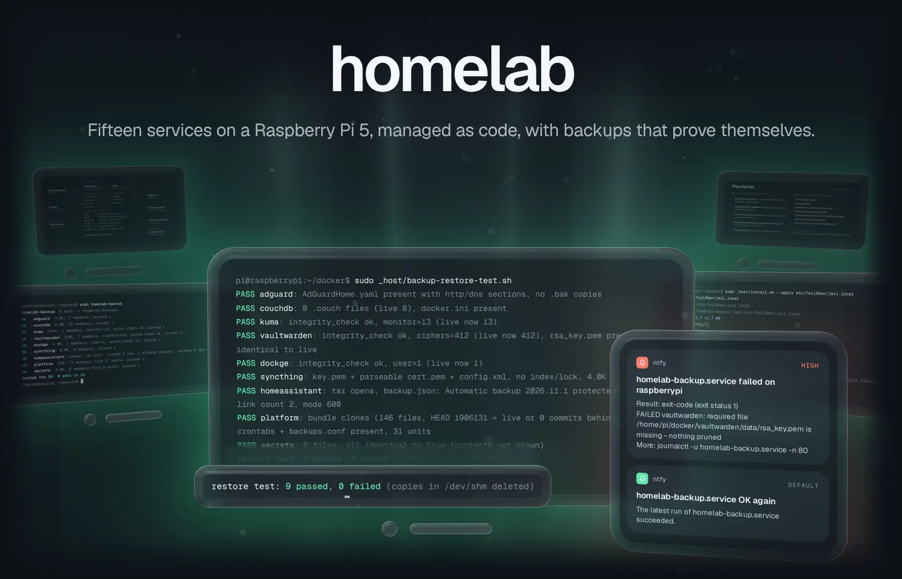</picture></a><a href="docs/README.md#gh-light-mode-only"><picture><source media="(max-width: 767px)" srcset="docs/readme/hero-light-phone.webp 2.835x"><source srcset="docs/readme/hero-light.webp 2x">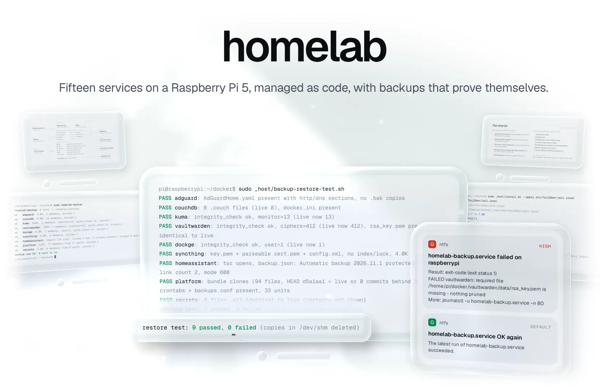</picture></a>

A household quietly depends on a few services: DNS, the password vault, notes, the smart home. This repo runs them on one Raspberry Pi 5 the way an operations team would. Every hand-written file, host configuration included, lives in git at its live path, and a tool proves the machine still matches. Each night the backups are written, verified and only then pruned, and each week a drill restores them. A failure reaches one phone as one push, and an always-on Claude Code session investigates it under a written charter.

<p align="center"><a href="#quickstart"><b>Quickstart</b></a> &nbsp;·&nbsp; <a href="#how-it-works">How it works</a> &nbsp;·&nbsp; <a href="https://github.com/gallowforge/homelab/releases">Releases</a></p>

<a href="docs/design-decisions.md#gh-dark-mode-only"><picture><source media="(max-width: 767px)" srcset="docs/readme/numbers-dark-phone.webp 2.835x"><source srcset="docs/readme/numbers-dark.webp 2x">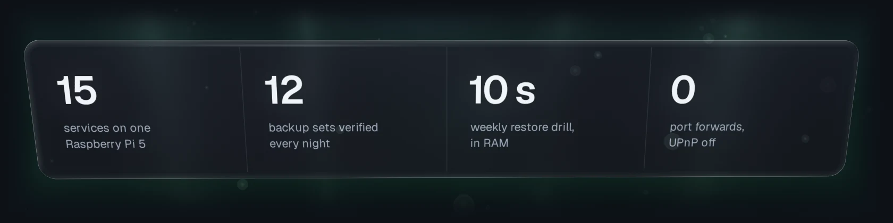</picture></a><a href="docs/design-decisions.md#gh-light-mode-only"><picture><source media="(max-width: 767px)" srcset="docs/readme/numbers-light-phone.webp 2.835x"><source srcset="docs/readme/numbers-light.webp 2x"></picture></a>

<sub>Figures from the live Pi. This public copy carries 9 of its 15 containers, 9 of its 12 backup sets and 12 of its 21 timers; see <a href="#what-this-copy-leaves-out">what it leaves out</a>. Every terminal in these images is real output of this repo's scripts, run by <a href="scripts/readme-demo.sh"><code>scripts/readme-demo.sh</code></a> on synthetic data.</sub>

## Backups are verified before anything is deleted

The [backup engine](_host/usr/local/sbin/homelab-backup) writes every set in [`backups.conf`](_host/etc/homelab/backups.conf), checks it (SQLite `quick_check` and row counts, required members) and only then prunes older archives, never the newest three. A set that fails keeps everything it had and sends one push. The archives leave for a desktop PC, which pulls them nightly without `--delete`, and for a MacBook every 20 minutes.

<a href="docs/backups-and-restore.md#gh-dark-mode-only"><picture><source media="(max-width: 767px)" srcset="docs/readme/backups-dark-phone.webp 2.835x"><source srcset="docs/readme/backups-dark.webp 2x">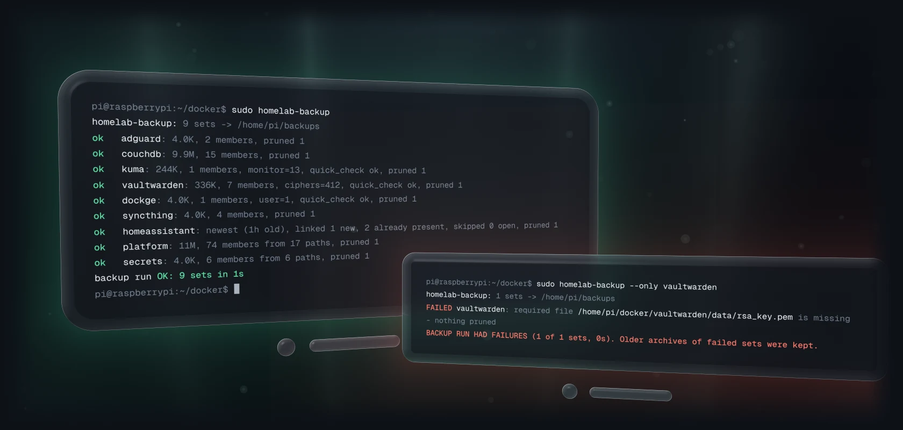</picture></a><a href="docs/backups-and-restore.md#gh-light-mode-only"><picture><source media="(max-width: 767px)" srcset="docs/readme/backups-light-phone.webp 2.835x"><source srcset="docs/readme/backups-light.webp 2x">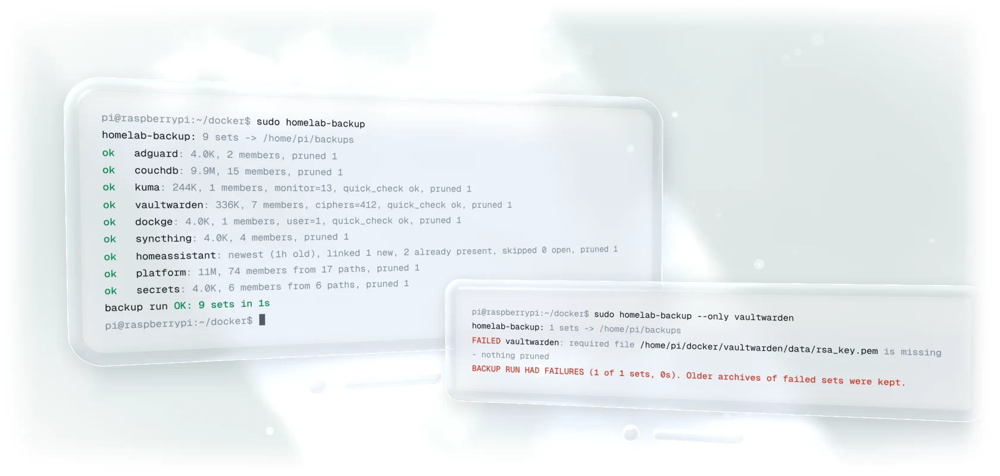</picture></a>

## A backup only counts once it has been restored

Every Sunday at 05:45 the [restore drill](_host/backup-restore-test.sh) unpacks the newest archive of every set into RAM and checks it against the live data: integrity checks and row counts, the vault's signing key byte for byte, the git bundle against the live `HEAD`, the secrets compared without ever being printed. It takes about 10 seconds and writes nothing to the flash stick.

<a href="docs/backups-and-restore.md#gh-dark-mode-only"><picture><source media="(max-width: 767px)" srcset="docs/readme/drill-dark-phone.webp 2.835x"><source srcset="docs/readme/drill-dark.webp 2x">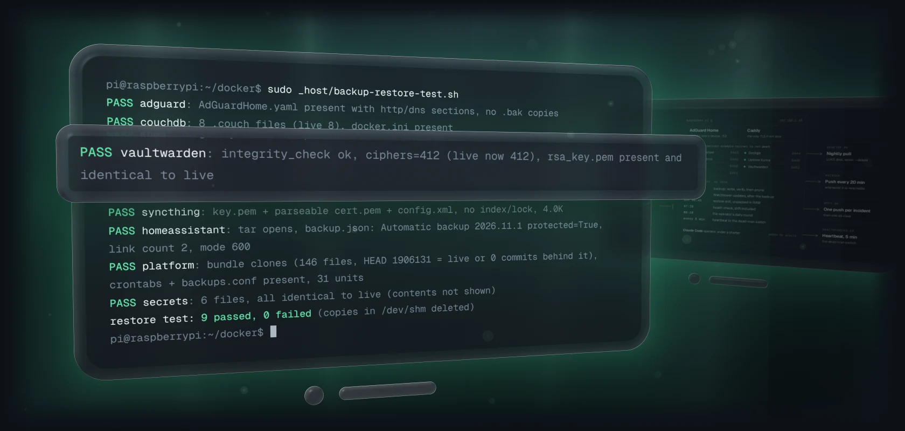</picture></a><a href="docs/backups-and-restore.md#gh-light-mode-only"><picture><source media="(max-width: 767px)" srcset="docs/readme/drill-light-phone.webp 2.835x"><source srcset="docs/readme/drill-light.webp 2x">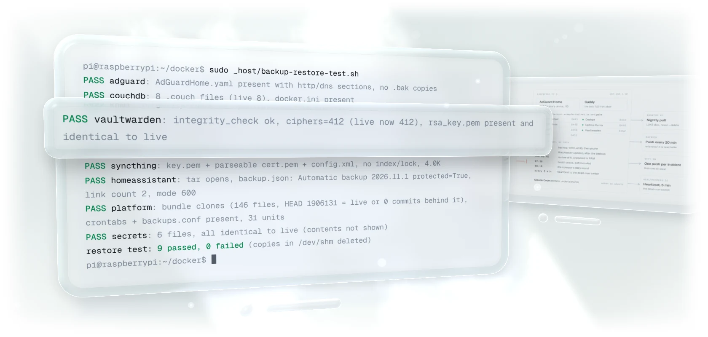</picture></a>

## One incident, one push, one all-clear

Every alert goes through [one notifier](_host/usr/local/bin/homelab-notify.sh): at most one push per incident and interval, and an all-clear only if the alert really reached the phone. A failed unit [quotes its own log lines](_host/usr/local/sbin/homelab-failure-notify), with known credential patterns redacted. With nothing open, the all-clear call does nothing at all: silence means healthy.

<a href="docs/monitoring-and-alerts.md#gh-dark-mode-only"><picture><source media="(max-width: 767px)" srcset="docs/readme/alerts-dark-phone.webp 2.835x"><source srcset="docs/readme/alerts-dark.webp 2x">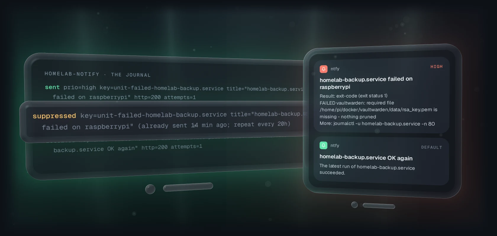</picture></a><a href="docs/monitoring-and-alerts.md#gh-light-mode-only"><picture><source media="(max-width: 767px)" srcset="docs/readme/alerts-light-phone.webp 2.835x"><source srcset="docs/readme/alerts-light.webp 2x">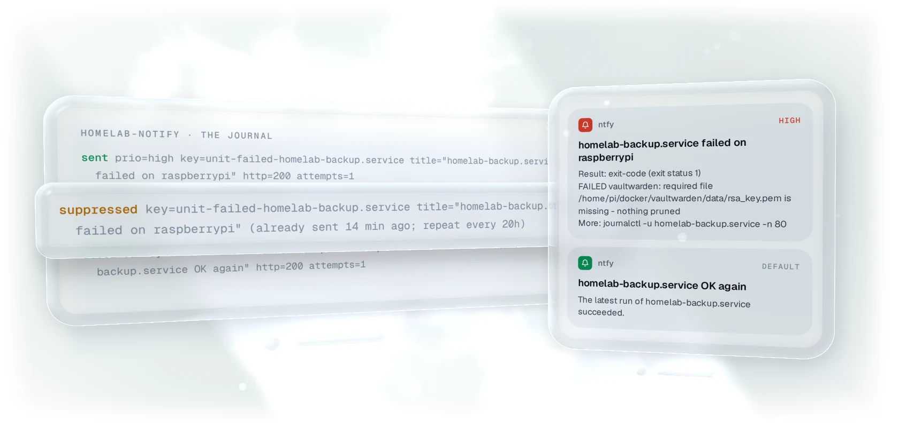</picture></a>

## The repo is the machine

Host files live in [`_host/`](_host) at their live paths, and [`MANIFEST`](_host/MANIFEST) gives each one its mode, owner and the follow-up a change needs. [`install.sh`](_host/install.sh) compares every entry with the live system and ends with `RESULT: no drift` or the difference. `--apply` refuses uncommitted files, keeps the old copy and prints follow-ups instead of restarting anything. The daily health check runs the same comparison.

<a href="docs/design-decisions.md#gh-dark-mode-only"><picture><source media="(max-width: 767px)" srcset="docs/readme/drift-dark-phone.webp 2.835x"><source srcset="docs/readme/drift-dark.webp 2x">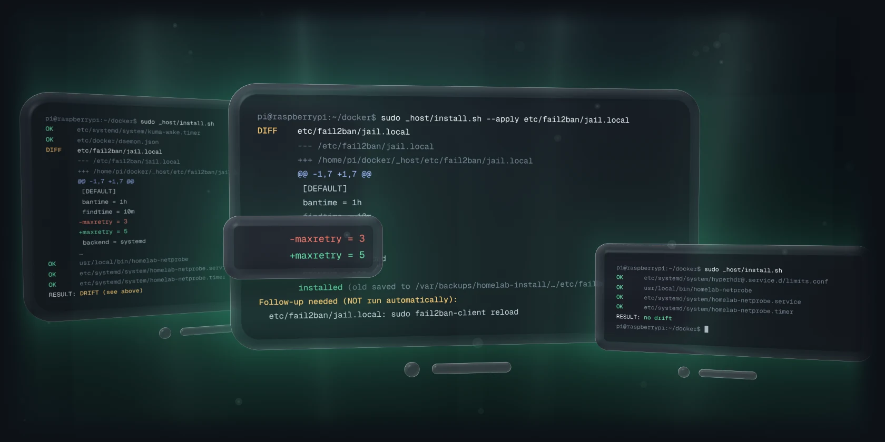</picture></a><a href="docs/design-decisions.md#gh-light-mode-only"><picture><source media="(max-width: 767px)" srcset="docs/readme/drift-light-phone.webp 2.835x"><source srcset="docs/readme/drift-light.webp 2x">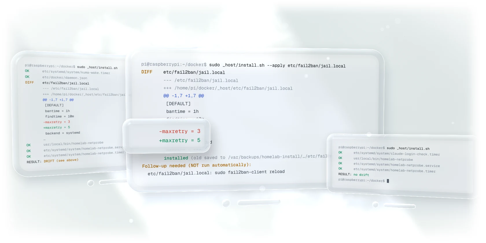</picture></a>

## An AI operator on call, under a written charter

An always-on Claude Code session is woken by alerts and runs a daily round at 08:10. It works to a priority order, with lines that a blanket "yes" does not move, and every change it makes is a commit with a reason. Alerts it causes reach the owner's phone like any other, and one command stops it. More in [docs/ai-operator.md](docs/ai-operator.md).

<a href="docs/ai-operator.md#gh-dark-mode-only"><picture><source media="(max-width: 767px)" srcset="docs/readme/operator-dark-phone.webp 2.835x"><source srcset="docs/readme/operator-dark.webp 2x"></picture></a><a href="docs/ai-operator.md#gh-light-mode-only"><picture><source media="(max-width: 767px)" srcset="docs/readme/operator-light-phone.webp 2.835x"><source srcset="docs/readme/operator-light.webp 2x"></picture></a>

## How it works

AdGuard answers DNS for every device in the house. Caddy is the only TLS front door, one port per app on the tailnet name, and devices away from home come in over Tailscale; nothing is forwarded from the internet. Each service is a Docker Compose stack, and the host jobs are systemd timers that report failures through one alert template.

<a href="docs/design-decisions.md#gh-dark-mode-only"><picture><source media="(max-width: 767px)" srcset="docs/readme/topology-dark-phone.webp 2.835x"><source srcset="docs/readme/topology-dark.webp 2x"></picture></a><a href="docs/design-decisions.md#gh-light-mode-only"><picture><source media="(max-width: 767px)" srcset="docs/readme/topology-light-phone.webp 2.835x"><source srcset="docs/readme/topology-light.webp 2x"></picture></a>

| Question | Method |
| --- | --- |
| How do devices away from home get in? | Tailscale (WireGuard): CGNAT and no IPv6 rule out port forwarding. At home, AdGuard answers the tailnet name with the LAN address, so the same HTTPS links work everywhere. [More](docs/design-decisions.md#tailscale-instead-of-port-forwarding) |
| What stops Docker from bypassing the firewall? | Docker publishes ports with DNAT, which skips ufw's INPUT rules. [`after.rules`](_host/etc/ufw/after.rules) fills `DOCKER-USER`, so a published port stays closed to anything arriving on `eth0` from outside the LAN. [More](docs/design-decisions.md#closing-dockers-ufw-bypass) |
| What if the Pi's DNS stops? | No fallback resolver, on purpose: Apple devices raced it and lost every local name. Parallel DoH upstreams, `oom_score_adj: -500`, a DNS probe every 60 s and an urgent push. [More](docs/design-decisions.md#no-fallback-dns-on-purpose) |
| How are updates applied? | Watchtower at 05:30, after the verified backup: labelled containers only, images at least 3 days old, one container at a time. [More](docs/design-decisions.md#updates-in-tiers-after-the-backup) |
| How is the flash stick protected? | Scratch data in RAM (`/run`, `/dev/shm`, zram), a capped journal, alerts on heavy writes or a USB 2 link, and no hardware watchdog. [More](docs/design-decisions.md#written-for-a-flash-stick) |
| How is the Pi's own death noticed? | A heartbeat to healthchecks.io every 5 minutes, withheld when Uptime Kuma is unhealthy or the health check has not run for 29 hours. [More](docs/monitoring-and-alerts.md#dead-man-switch) |

Every rule above came from something that broke; the seven that cost the most, and what each one changed, are in [past failures](docs/past-failures.md).

<details>
<summary><b>Goals, in priority order</b></summary>
<br />

When two goals conflict, the lower number wins.

1. **Never lose data.** The password vault, notes, the personal vault, Home Assistant's config and the backups themselves come before uptime and before convenience. A backup counts only once a restore has read it back.
2. **Private by default.** Nothing is reachable from the internet unless that was a deliberate, written decision. No forwarded ports, no new public names, no secret in git.
3. **The house keeps working.** DNS first, then the vault and Home Assistant. Risky work happens after the backup, one container at a time, and fails loudly instead of quietly falling back to something that half works.
4. **Every change is visible, reproducible and reversible.** Git holds every hand-written file, the install tool refuses uncommitted host files, and the operator's actions are in the git log and a journal.
5. **Low maintenance.** Automated checks over manual care. A manual step that has to be remembered is treated as a bug in the tooling.

The hardware watchdog stays off because on this flash stick an abrupt reset costs data (1 beats 3). Updates wait for the verified backup and a 3-day cooldown, even though known fixes then wait a few days (1 beats 5).

</details>

<details>
<summary><b>Services and how each is reached</b></summary>
<br />

| Service | What it does | How it is reached |
|---|---|---|
| AdGuard Home | DNS and ad blocking for every device in the house | `:53`; web UI through Caddy `:8445` |
| Caddy | The only TLS front door. One port per site, tailnet certificate | `:8443-8453` |
| Vaultwarden | Bitwarden-compatible password server | Caddy `:8452` only, no host port |
| CouchDB | Obsidian LiveSync backend | Caddy `:8450` only, no host port |
| Home Assistant | Home automation, HomeKit bridges, Hue scenes, TV picture mode | Caddy `:8443`; LAN `:8123` for phone shortcuts |
| Syncthing | Replicates a personal file vault to the PC and the MacBook | GUI through Caddy `:8453` |
| Uptime Kuma | Endpoint monitors, alerts through ntfy | Caddy `:8446` only, no host port |
| Dockge | Web UI for the compose stacks. Holds `docker.sock` | Caddy `:8444` only, no host port |
| Watchtower | The only automatic updater, with tiers and a cooldown | none |
| HyperHDR + tv-mood | Hue lamps follow the TV picture | host services, see [docs/tv-ambient-lighting.md](docs/tv-ambient-lighting.md) |
| Claude Code | Always-on operator session | host service, see [docs/ai-operator.md](docs/ai-operator.md) |

Host: Raspberry Pi OS Lite 64-bit (Debian 12), Docker CE with Compose, Tailscale. The root filesystem is on a USB flash stick, which shapes many of the [design decisions](docs/design-decisions.md).

</details>

<details>
<summary><b>Repository layout</b></summary>
<br />

```
.
├── adguard/                 DNS: compose file, self-healing rewrite pin (pin-update.sh)
├── caddy/                   TLS front door: compose file, Caddyfile
├── couchdb/                 Obsidian LiveSync backend
├── dockge/                  compose UI
├── homeassistant/           compose file, YAML config, Hue scenes, TV picture mode
├── syncthing/               vault replication
├── uptime-kuma/             endpoint monitors
├── vaultwarden/             password server
├── watchtower/              tiered updater
├── _host/                   host files, stored at their live paths
│   ├── MANIFEST             every host file: mode, owner, follow-up after a change
│   ├── install.sh           diff, apply, pull, bootstrap
│   ├── etc/                 docker, ufw, fail2ban, journald, sysctl, tmpfiles,
│   │                        systemd units, the backup list
│   ├── usr/local/           backup engine, health check, notifier, heartbeat gate,
│   │                        netprobe, caretaker scripts, tv-mood
│   ├── backup-restore-test.sh   the weekly restore drill
│   ├── watchdog-tests.sh        stubbed tests for the notifier and netprobe
│   └── git-hooks/pre-commit     refuses secrets
├── docs/                    the deeper write-ups, indexed in docs/README.md
│   └── readme/              README images, their sources and the captured demo output
├── scripts/                 readme-demo.sh (sandboxed demo runs), readme-visuals.sh (renders)
├── .github/workflows/       CI: validate.yml
├── SECURITY.md              threat model, secret handling, how to report
└── CHANGELOG.md
```

Each stack keeps its secrets in a `.env` file (mode 600, never tracked); the `.env.example` beside it lists the variable names. Host scripts read `/etc/homelab/secrets.env`, whose names are in [`secrets.env.example`](_host/etc/homelab/secrets.env.example).

</details>

### What this copy leaves out

The live repo is private, and this copy differs from it in three ways:

- **Services removed.** A few services, a public Funnel endpoint and their watchdogs and timers are not here, nor are scripts that reach into other personal machines. Where a kept script checked those services, the checks were removed and the script re-validated.
- **Values replaced.** LAN addresses are `192.168.1.x` (the Pi is `192.168.1.10`), tailnet addresses `100.64.0.x`, the tailnet `example-tailnet.ts.net` and the account `pi`. Device IDs, MAC addresses and a session ID are placeholders.
- **Private documents condensed.** The runbooks, the operator's charter and its journal stay private; the files in [`docs/`](docs) are public versions.

## Quickstart

Run the checks CI runs. Nothing here touches a live system:

```bash
git clone https://github.com/gallowforge/homelab.git && cd homelab

# parse and validate the backup list
HOMELAB_BACKUP_CONF=_host/etc/homelab/backups.conf bash _host/usr/local/sbin/homelab-backup --check-config

# the stubbed tests for the notifier and the network probe (they reach no Docker, curl or ntfy)
d=$(mktemp -d) && mkdir -p "$d/bin" && cp _host/watchdog-tests.sh "$d/run-tests.sh"
cp _host/usr/local/bin/*.sh _host/usr/local/bin/homelab-netprobe "$d/bin/"
TEST_TMP="$d/tmp" bash "$d/run-tests.sh"          # RESULT: 43 passed, 0 failed

# replay the README demos: the real scripts in a bubblewrap sandbox on synthetic data
scripts/readme-demo.sh
```

To adapt it to your own Pi (Raspberry Pi OS Lite 64-bit, Docker CE with Compose, Tailscale), clone it to `~/docker` and replace the placeholders `192.168.1.x`, `100.64.0.x`, `example-tailnet.ts.net` and the user `pi`. Every compose file reads its time zone from `TZ`, a tz database name such as `Europe/Berlin`, and falls back to `UTC` when it is unset: put `TZ=...` in each stack's `.env`. The host timers run on the system time zone (`sudo timedatectl set-timezone <zone>`). Then:

```bash
for f in */.env.example; do install -m 600 "$f" "${f%.example}"; done   # then fill in each .env
sudo install -D -m 600 _host/etc/homelab/secrets.env.example /etc/homelab/secrets.env

sudo _host/install.sh               # diff: on a fresh host every entry shows as MISSING
sudo _host/install.sh --apply       # install the host files (commit first: it refuses a dirty _host/)
sudo _host/install.sh --bootstrap   # Docker network 'proxy', enable every timer

(cd adguard && docker compose up -d)   # DNS first, then the other stacks, Uptime Kuma last
sudo homelab-backup && sudo homelab-health.sh --dry-run   # must end with 'all healthy'
```

Every later change follows one path: edit the file in the repo (host files under `_host/`), `git commit` (the [pre-commit hook](_host/git-hooks/pre-commit) blocks known secret patterns), `sudo _host/install.sh --apply`, then check it from a client's side until `sudo homelab-health.sh --dry-run` ends with `all healthy` and `sudo _host/install.sh` with `RESULT: no drift`.

## Quality

Every push and pull request runs [`validate.yml`](.github/workflows/validate.yml), and each step runs the same way on a workstation.

| Check | What it covers |
| --- | --- |
| `bash -n` and `shellcheck --severity=error` | All 18 shell scripts, found by shebang, since most host scripts have no extension |
| `python -m py_compile` | All 5 Python files |
| YAML parse | All 14 compose and Home Assistant files; HA's `!include` and `!secret` tags are read as opaque values |
| `homelab-backup --check-config` | The backup list: 9 sets, every key and path validated |
| Stubbed tests | 43 checks of the notifier and the network probe behind three layers of stubs; a run must end with zero real calls |
| gitleaks | The full git history, on every push |

The README images are rebuilt from the same evidence: [`scripts/readme-demo.sh`](scripts/readme-demo.sh) runs the backup engine, the restore drill, `install.sh` and the alert path in a sandbox, and [`scripts/readme-visuals.sh`](scripts/readme-visuals.sh) renders that output as glass. Secrets and how to report one: [SECURITY.md](SECURITY.md).

## FAQ

<details>
<summary><b>Can I run this on my own Pi?</b></summary>
<br />
Yes, as a starting point. It is a working configuration rather than an installer: replace the placeholders, fill in the <code>.env</code> files and follow the <a href="#quickstart">Quickstart</a>. The rebuild in <a href="docs/backups-and-restore.md#rebuilding-a-dead-pi">docs/backups-and-restore.md</a> is the same path from bare hardware.
</details>

<details>
<summary><b>Why give an AI session root on the house server?</b></summary>
<br />
Because nobody is awake to answer a prompt at 3 a.m., and the failures worth an agent are the ones no rule predicted. Its limits come from elsewhere: a written charter with lines it does not cross, systemd, git for every change, and the same alert path the owner sees. The every-minute layer stays plain machinery, and one command stops the agent. See <a href="docs/ai-operator.md">docs/ai-operator.md</a>.
</details>

<details>
<summary><b>Why is there no fallback DNS server?</b></summary>
<br />
One was tried. Apple devices race every configured resolver, the public one answered "no such name" for the Pi, and that answer often won, so every local link broke. The single point of failure is managed in place instead. See <a href="docs/design-decisions.md#no-fallback-dns-on-purpose">No fallback DNS, on purpose</a>.
</details>

<details>
<summary><b>What happens when the Pi dies?</b></summary>
<br />
First aid is to point the router's DHCP at a public resolver until AdGuard is back. The Pi is then rebuilt from the newest archives on the PC, about 2 to 3 hours of work. The backup sets can lose up to about 26 hours; the personal vault loses nothing, because its other copies refill the new Pi. If the PC is gone too, the MacBook holds every set except <code>secrets</code>, <code>syncthing</code> and <code>dockge</code>.
</details>

<details>
<summary><b>Why systemd timers and no cron?</b></summary>
<br />
A unit can carry <code>OnFailure=homelab-failure@%n.service</code>, so a failed job becomes one push quoting its own log lines, and its next success sends the all-clear. Each run gets its own journal entry, and the daily jobs catch up after downtime with <code>Persistent=true</code>.
</details>

## Contributing

Issues and pull requests are welcome, especially a check that would have caught one of the [past failures](docs/past-failures.md) earlier; run the [Quickstart](#quickstart) checks first, keep every value a placeholder, and send a committed secret to the address in [SECURITY.md](SECURITY.md), not to an issue.

## Licence

[MIT](LICENSE). Built and run by Ali Husain.
