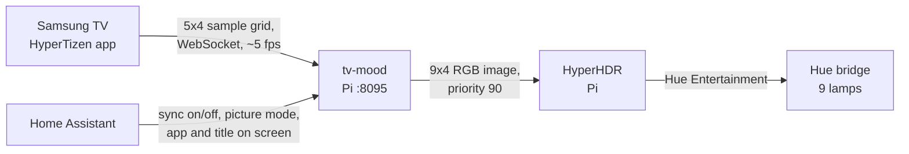

# TV ambient lighting

Nine Hue lamps in the bedroom follow the TV picture, from any source on the TV, with no
Hue Sync Box and the PC off.

## The chain

- **On the TV**, a patched build of HyperTizen (an open-source Tizen app for HyperHDR)
  samples a 5x4 grid over the picture about 5 times a second and sends it to the Pi. Each
  cell rotates through 4 shifted spots, and rows sit between 20% and 80% of the height to
  miss letterbox bars. The patches are not in this copy.
- **[`tv-mood`](../_host/usr/local/bin/tv-mood)** on the Pi turns those noisy samples into
  a calm room colour:
  - Per cell, the median of its last 4 readings. A still picture gives the same value every
    time.
  - Colour math in linear light. HDR and Dolby Vision are decoded from PQ and BT.2020 when a
    media server reports the stream as HDR (optional).
  - Each lamp follows its own part of the picture, mixed with a share of the whole scene,
    mapped from where the lamp stands in the room.
  - Vivid and bright samples lead, so black bars drop out.
  - Colour follows in about 0.45 s. Brightness always glides, capped at 35% of full range
    per second, so a flash or a cut to black fades instead of jumping.
- **HyperHDR** streams the result to the Hue bridge over the Entertainment API.
- **Home Assistant** decides when it runs. The owner's "Sync lights" shortcut turns it on;
  every lighting routine and "Stop syncing" turn it off. When off, tv-mood sends nothing,
  so switching the TV on cannot start the sync by itself. The TV's picture mode caps the
  brightness: Standard 100%, Movie 80%, Filmmaker Mode 60%.

A small director thread hands the lamps back to the Hue app after 10 seconds without a
picture, and takes them again when one returns. A fireplace or candle video gets its own
mode: the whole room takes the fire's colour and breathes with it, nearest lamps brightest.

## The guard timer

HyperHDR leaks memory for every client connection it accepts. Opening one connection per
second took it to 2.6 GB in two days; the Pi swapped to its flash stick and DNS slowed for
the whole house. Three fixes:

1. Every client keeps one connection open instead of reconnecting (tv-mood and
   [`room-show.py`](../_host/usr/local/lib/room-show.py) do).
2. [`hyperhdr-guard.timer`](../_host/etc/systemd/system/hyperhdr-guard.timer) checks its
   memory every minute and restarts it past 300 MB. A systemd memory limit would be the
   cleaner fix, but Raspberry Pi OS boots with the memory cgroup disabled, so `MemoryMax=`
   is silently ignored.
3. A [drop-in](../_host/etc/systemd/system/hyperhdr@.service.d/limits.conf) gives it
   `Nice=10` and low CPU and I/O weight, so house services always come first.

The health check reports at low priority when HyperHDR or tv-mood is not running: comfort,
not data.

## Testing it

Measure on a paused frame, not a moving film. On a still picture the per-frame step of
every lamp should be about zero. A moving picture hides a wobble that a still one shows
at once.
